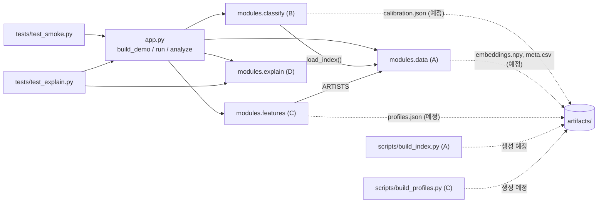
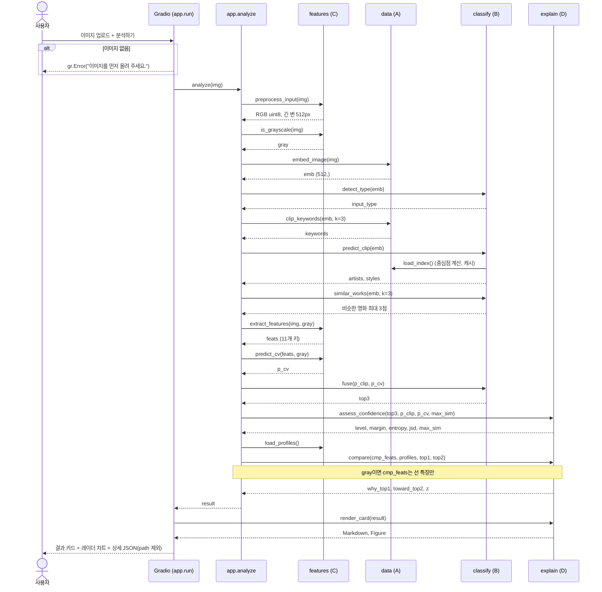
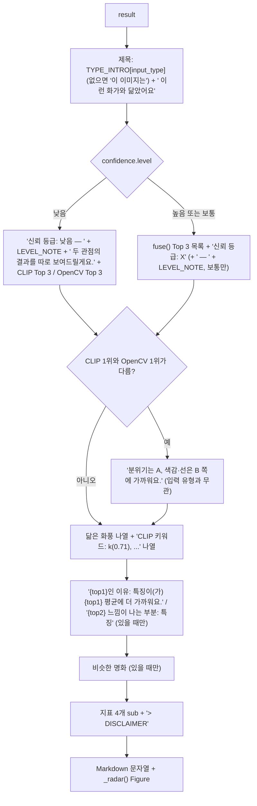
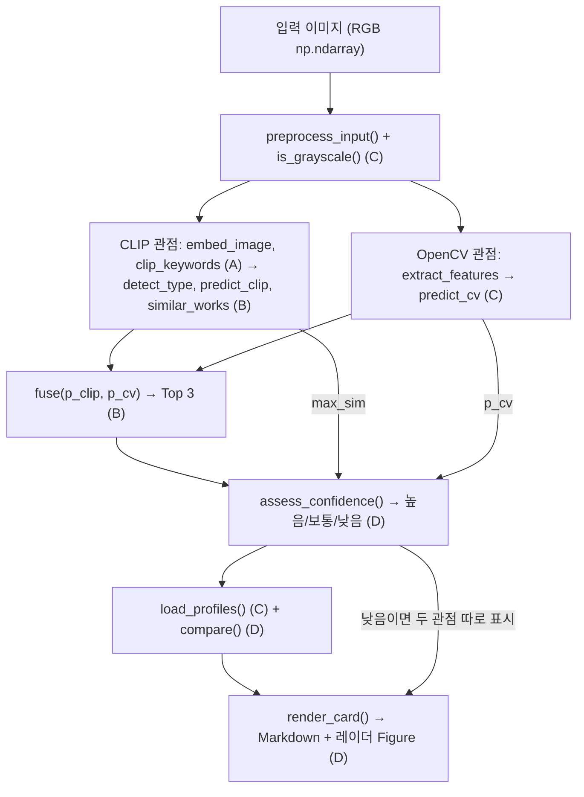
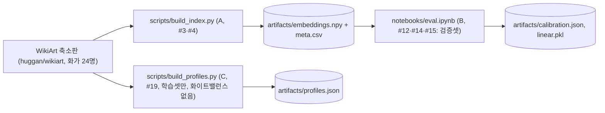

# Architecture

## Architecture Analysis

### System Overview

단일 프로세스 로컬 Python 앱이다. `app.py`가 Gradio Blocks 화면을 띄우고, 버튼을 누르면 `app.run()` → `app.analyze()`가 `modules/` 패키지의 4개 모듈 함수를 정해진 순서로 호출해 `result` dict를 만든 뒤 `explain.render_card()`가 결과 카드(Markdown)와 레이더 차트(matplotlib `Figure`)를 만든다. 사전 계산 결과는 `artifacts/`의 파일(임베딩·메타·프로필·보정값)로 공유하도록 설계돼 있으나 지금은 비어 있고, 스텁이 같은 모양의 가짜 데이터를 메모리에서 만든다.

### Architectural Style

모듈형 모놀리스(Modular Monolith) + 파이프라인. 근거:

- 배포 단위 1개(`python app.py`), 네트워크 경계 없음, DB 없음
- 모듈 경계 = 담당자 경계 = 파일 경계(A `data.py`, B `classify.py`, C `features.py`, D `explain.py`·`app.py`). 경계의 기준은 `contracts/interfaces.md`의 함수 시그니처
- 처리 흐름은 순차 파이프라인이며, 각 단계는 순수 함수에 가깝다(입력 → dict/배열). 상태는 `functools.lru_cache`로 캐시한 색인·프로필·글꼴뿐

### Component Relationships

Text fallback: app.py는 features(C), data(A), classify(B), explain(D)를 모두 호출한다. classify는 data.load_index()를, features는 data.ARTISTS를 import한다. explain과 data는 다른 모듈을 import하지 않는다. data·features·classify는 artifacts/의 embeddings.npy·meta.csv, profiles.json, calibration.json을 읽도록 예정돼 있고, scripts/build_index.py와 scripts/build_profiles.py가 그 파일을 만들 예정이다. tests/test_smoke.py는 app과 모든 모듈을, tests/test_explain.py는 explain과 app.analyze를 호출한다.

모듈 간 실제 import는 두 개뿐이다: B → A(`load_index`), C → A(`ARTISTS`). D(`explain.py`)는 다른 모듈을 import하지 않고 인자로 받은 dict만 쓴다. 상세 목록은 `dependencies.md`.

### UI 계층 (D: `app.py` + `modules/explain.py`)

| 층 | 위치 | 역할 | 고정 여부 |
| --- | --- | --- | --- |
| (1) 조립 | `app.analyze(img)` | 파이프라인 호출 → `result` dict(12개 키, 계약 표는 11행 — `p_clip_top`·`p_cv_top`이 한 행) | 형식 고정(계약 + 테스트) |
| (2) 표현 | `explain.render_card(result)`, `_radar()`, 문구 상수 | `result` → Markdown 카드 + 레이더 `Figure` | `render_card` 반환 형식과 `DISCLAIMER` 포함만 고정. 문장 내용·문구 상수·계약 밖 보조 함수는 D가 바꿀 수 있음 |
| (3) 화면 | `app.build_demo()`, `app.run(img)` | Gradio 컴포넌트·이벤트 연결, 상세 JSON 정리 | `run()` 반환 `(text, fig, detail)` 고정, 화면 구조는 테스트 없음 |

#22(해석 문장)는 (2)만 바꾸는 작업이다. (1)이 넘기는 `result`는 그대로 쓰고, (3)은 `render_card()`의 Markdown 문자열을 `gr.Markdown`에 그대로 넣으므로 문장이 바뀌어도 화면 코드는 바뀌지 않는다. 현재 (3)은 2열 `gr.Row`(왼쪽 이미지·버튼, 오른쪽 카드·레이더) + 접힌 `gr.Accordion("상세 수치")` 한 장이며 CSS·JS·정적 파일을 쓰지 않는다(#37 G안 화면은 이 브랜치에 없음).

### Data Flow

1. 사용자 이미지(Gradio `type="numpy"`, `image_mode="RGB"`) → `app.run()`이 `None`이면 `gr.Error` → `features.preprocess_input()`: RGB uint8, 긴 변 512px
2. `features.is_grayscale()` → `gray` 플래그
3. CLIP 관점: `data.embed_image()` → 512차원 L2 정규화 벡터 → `classify.detect_type()`(→ `input_type`), `data.clip_keywords(emb, k=3)`(→ `keywords`), `classify.predict_clip()`(화가·화풍 확률), `classify.similar_works()`(색인 코사인 검색, 0.95 이상 제외)
4. OpenCV 관점: `features.extract_features()`(11개 키) → `features.predict_cv()`(z값 거리 → 확률, 스케치는 선 특징만)
5. `classify.fuse(p_clip, p_cv)` → Top 3 `[(artist, prob)]`
6. `explain.assess_confidence(top3, p_clip, p_cv, max_sim)` → 등급·지표. `max_sim = similar[0]["score"]`, 비슷한 명화가 없으면 `0.0`
7. `features.load_profiles()` + `explain.compare(cmp_feats, profiles, top1, top2)` → 1·2위 대조. `gray`이면 `cmp_feats`는 `features.LINE_FEATURES`만, 아니면 전체. 2위가 없으면 `top2 = top1`(대조 목록 비움)
8. `result` dict(12개 키, `features`는 스케치여도 11개 그대로) → `explain.render_card()` → (Markdown, Figure). 카드 문장에 쓰이는 키: `input_type`(제목), `confidence.level`(등급 분기·문구), `keywords`(키워드 줄), `top3`·`p_clip_top`·`p_cv_top`·`styles_top3`·`comparison`·`similar`·`confidence` 지표. `gray`는 카드에서 쓰지 않는다
9. `app.run()`은 상세 JSON(`input_type`, `confidence`, `CLIP Top 3`, `OpenCV Top 3`, `similar_works`)을 만들 때 `similar`의 `path` 키를 뺀다(Gradio가 파일로 오인하는 문제)

### Key Design Decisions

| 결정 | 근거 / 영향 |
| --- | --- |
| 계약 우선(contract-first): `contracts/interfaces.md`를 변경 불가 기준으로 둠 | 4명이 병렬로 일하면서 통합 깨짐을 막음. 변경은 계약 변경 이슈 템플릿 + 별도 PR |
| 1일차 스텁이 빈 함수가 아니라 같은 모양의 결정적 가짜 값을 돌려줌 | 첫날부터 `app.py`와 `tests/test_smoke.py`가 끝까지 돎. 같은 입력 → 같은 출력(입력 바이트 SHA-1 시드) |
| 최종 순위는 `fuse()`만 결정 | OpenCV·키워드가 순위를 몰래 뒤집지 않음. 엇갈림은 카드 문장으로 노출 |
| D의 등급 판정은 스텁이 아니라 plan.md 6.3 식을 실제 계산(경계값만 임시) | 통합 전에 등급·카드 로직을 검증 가능. 경계값은 #24에서 검증셋으로 확정 |
| `compare()`는 특징 이름만 돌려주고 문장은 `render_card()`가 만듦 | 계약 확인 사항 3. 문장 개편(#22)이 `compare()`·계약을 건드리지 않음 |
| 화면 문구를 `explain.py` 모듈 상수(`FEATURE_KO`, `TYPE_INTRO`, `LEVEL_NOTE`, `DISCLAIMER`)에 모음 | 문구의 단일 출처. `app.py`도 `explain.DISCLAIMER`를 씀. 단, 카드의 나머지 문구는 아직 `render_card()` 안 f-string |
| 표현(`render_card`)과 화면(`build_demo`)을 분리 | 카드·차트 형식은 계약·테스트로 고정하고, 화면 배치는 테스트 없이 바꿀 수 있음 |
| 스케치 대조 기준은 호출하는 쪽(`app.analyze`)이 정함 | `compare()`는 받은 특징만 비교하는 순수 함수로 유지(#21). `predict_cv(gray=True)`와 같은 기준 |
| 사전 계산 결과를 `artifacts/` 파일로 공유 | CLIP 계산을 한 번만(Colab GPU). 100MB 이상 파일 금지 |
| 보정값 기본값 `T=1, w=0.8, weighted_sum`(`classify.DEFAULT_CALIBRATION`) | plan.md 9.5 플랜 B와 같음. `calibration.json`이 생기면 덮어씀 |

### Improvement Opportunities

- B·C → A의 직접 import는 "Unit은 서로 의존하지 않는다"는 팀 결정과 코드 수준에서 어긋난다. 화가 목록·색인을 `artifacts/` 파일 계약으로만 주고받게 하거나, 의존을 계약 경유로 명시하는 방법을 정해야 한다(코드 변경은 각 담당자 이슈로).
- `T_cv`가 B 소유 `calibration.json`에 있는데 C의 `predict_cv()`는 `T = 1.0`을 하드코딩한다(2026-11-19 기준). 보정값 파일의 소유·읽기 경로를 정해야 한다.
- 화가 이름이 A(`meta.csv`)·B(확률 dict 키)·C(`profiles.json` 키)에서 같아야 한다는 암묵 계약이 있다(`app.py`의 `profiles[top1]`).
- 해석 문장이 입력 유형을 제목에만 쓰고, 등급은 "낮음"/그 외 두 갈래, 키워드는 나열뿐이다. 문장 조합(유형 × 등급 × 키워드)을 상수 표로 빼면 3×3 검사가 쉬워진다(#22). 상세는 `code-quality-assessment.md`의 D 영역.
- 레이더는 `result["features"]` 전체로, 대조는 스케치일 때 선 특징만으로 만든다. 화면에서 "선만 비교했다"와 색 축이 함께 보일 수 있다.
- 로깅·관측 수단이 없다. 로컬 MVP 범위에서는 수용 가능하나 엇갈림 사례 자동 저장(#25, `samples/disagree/`)이 사실상 유일한 기록 수단이 된다.

## Interaction Diagrams

### 이미지 분석 1회 (버튼 "분석하기")

Text fallback: 사용자가 이미지를 올리고 분석하기를 누르면 app.run이 이미지가 없을 때 gr.Error를 낸다. 있으면 app.analyze가 features.preprocess_input(긴 변 512px RGB uint8) → features.is_grayscale → data.embed_image(512차원) → classify.detect_type(input_type), data.clip_keywords(keywords), classify.predict_clip(내부에서 data.load_index 중심점), classify.similar_works → features.extract_features → features.predict_cv → classify.fuse(Top 3) → explain.assess_confidence(등급) → features.load_profiles + explain.compare(1·2위 대조, 스케치면 선 특징만) 순으로 호출해 result dict를 만든다. app.run은 explain.render_card로 Markdown 카드와 레이더 Figure를 받고, similar의 path 키를 뺀 상세 JSON과 함께 화면에 보여준다.

### 결과 카드 만들기 (`render_card` 분기, 2026-11-27 현재)

Text fallback: render_card는 TYPE_INTRO[input_type](없으면 "이 이미지는")에 "이런 화가와 닮았어요"를 붙여 제목을 만든다. 등급이 낮음이면 LEVEL_NOTE와 "두 관점의 결과를 따로 보여드릴게요."와 함께 CLIP·OpenCV 상위 3개를 따로, 높음·보통이면 fuse() Top 3와 등급을 보여 주고 보통일 때만 LEVEL_NOTE를 붙인다(높음 문구는 빈 문자열). 두 관점의 1위가 다르면 입력 유형과 상관없이 "분위기는 …, 색감·선은 … 쪽에 가까워요." 문장을 넣는다. 이어서 닮은 화풍과 CLIP 키워드를 점수와 함께 나열하고, 대조 문장(있을 때), 비슷한 명화(있을 때), 지표 4개(1·2위 차이, 엔트로피, JSD, 데이터셋 유사도)와 DISCLAIMER를 붙이며, _radar()가 만든 레이더 Figure와 함께 돌려준다. 입력 유형은 제목에만, 등급은 두 갈래 분기에만, 키워드는 나열에만 쓰인다 — #22가 바꿀 지점이다.

### 처리 흐름 요약 (image → preprocess → CLIP/OpenCV → fuse() → grade → result card)

Text fallback: 입력 이미지 → preprocess_input·is_grayscale(C) → 두 갈래(CLIP: embed_image·clip_keywords(A), detect_type·predict_clip·similar_works(B) / OpenCV: extract_features → predict_cv(C)) → fuse()로 Top 3(B) → assess_confidence()로 등급(D, max_sim과 p_clip·p_cv도 입력) → load_profiles(C)+compare(D) → render_card()(D)가 결과 카드와 레이더 차트를 만든다. 등급이 낮음이면 카드가 두 관점 결과를 따로 보여준다.

### 사전 계산 (예정, 아직 미구현)

Text fallback: WikiArt 축소판에서 scripts/build_index.py(A)가 embeddings.npy와 meta.csv를, scripts/build_profiles.py(C)가 학습셋만으로 profiles.json을 만들 예정이다. B는 eval.ipynb에서 검증셋으로 판정 방식·온도·가중치를 정해 calibration.json과 linear.pkl을 저장한다. 이 사전 계산 흐름은 2026-11-19 전체 스캔 기준이며 이후 집중 스캔에서 다시 확인하지 않았다.
