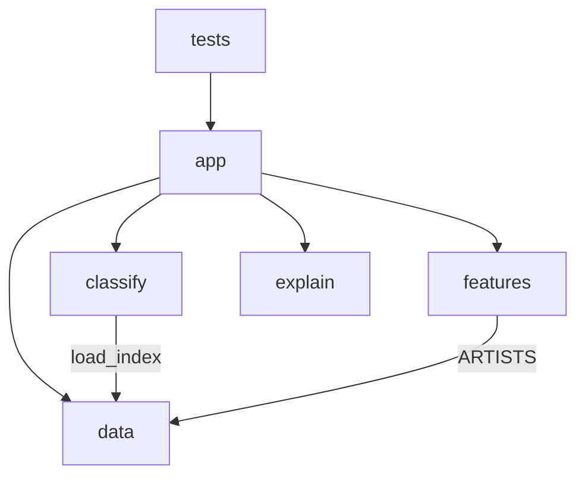

# Dependencies

외부 라이브러리 버전 목록은 `technology-stack.md`에 있다. 여기서는 의존 관계만 적는다.

## 내부 의존 (import 인접 목록)

```
app.py                 -> modules.classify, modules.data, modules.explain, modules.features
modules/data.py        -> (없음)
modules/classify.py    -> modules.data (load_index)          # classify.py:15
modules/features.py    -> modules.data (ARTISTS)             # features.py:17
modules/explain.py     -> (없음)
scripts/build_index.py -> (없음)
scripts/build_profiles.py -> (없음)
tests/test_smoke.py    -> app, modules.classify, modules.data, modules.explain, modules.features
```

순환 import 없음.


<!-- Text fallback: app은 data, classify, features, explain을 import한다. classify는 data의 load_index를, features는 data의 ARTISTS를 import한다. explain과 data는 내부 import가 없다. tests는 app(과 모든 모듈)을 import한다. 순환 없음. -->

### Unit 독립성과의 관계

팀 결정은 "Unit A·B·C·D는 서로 의존하지 않는다"이다. 파일 소유와 계약 경계는 분리돼 있지만, 코드에는 Unit 간 import가 2개 있다.

| 의존 | 내용 | 영향 |
| --- | --- | --- |
| B → A | `classify._centroids()`·`similar_works()`가 `data.load_index()` 호출 | A의 `load_index()` 반환 형식(계약)에 기댐. 계약을 지키는 한 A 내부 변경은 B에 영향 없음 |
| C → A | `features._profiles()`가 `data.ARTISTS`로 화가 목록을 만듦 | 계약 밖 상수에 기댐. 실제 구현에서 `profiles.json`을 쓰면 이 import는 필요 없어질 수 있음 |

`app.py`(D)는 통합 지점이라 모든 모듈을 import하는 것이 설계상 의도다. `explain.py`(D)는 다른 Unit을 import하지 않는다.

## 데이터·파일 의존 (예정)

| 소비자 | 파일 | 생산자 | 비고 |
| --- | --- | --- | --- |
| A `load_index()` | `artifacts/embeddings.npy`, `meta.csv` | A `scripts/build_index.py` | 같은 Unit 안 |
| C `load_profiles()` | `artifacts/profiles.json` | C `scripts/build_profiles.py` | 같은 Unit 안. 학습셋 필요 → A의 `split` 열에 의존 |
| B `load_calibration()`, `fuse()` | `artifacts/calibration.json` | B `eval.ipynb` | `T_cv`도 이 파일에 있음 → C `predict_cv()`가 읽을지 미정 |
| B `predict_clip()` | `artifacts/linear.pkl` | B (#11) | |
| D `app.analyze()` | (없음, 함수 반환값만) | | `profiles[top1]`이 A·B·C의 화가 이름 일치를 전제 |

## 외부 의존 그래프 (사용 중인 것만)

| 모듈 | 외부 패키지 |
| --- | --- |
| `app` | gradio, numpy |
| `modules.data` | numpy, pandas |
| `modules.classify` | numpy |
| `modules.features` | cv2(opencv-python-headless), numpy |
| `modules.explain` | numpy, scipy, matplotlib |
| `tests` | pytest, numpy, pandas, matplotlib |

torch, transformers, datasets, scikit-learn은 설치되지만 아직 어느 파일도 import하지 않는다.

## 외부 서비스

- Hugging Face Hub(데이터셋·CLIP 가중치 다운로드, 예정 — 사전 계산과 `embed_image` 실제 구현 시)
- PyTorch CPU wheel 인덱스(CI·Linux 설치)
- 런타임에 호출하는 외부 API·DB 없음. 비밀값·환경변수 사용 없음
