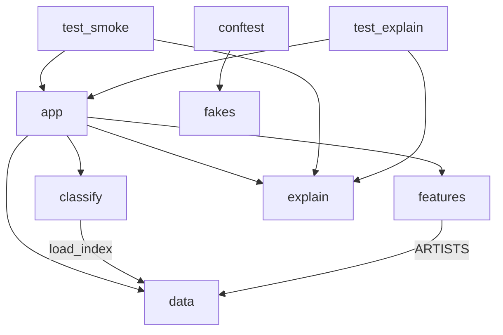

# Dependencies

외부 라이브러리 버전 목록은 `technology-stack.md`에 있다. 여기서는 의존 관계만 적는다.

## 내부 의존 (import 인접 목록)

```
app.py                    -> modules.classify, modules.data, modules.explain, modules.features
modules/data.py           -> (없음)
modules/classify.py       -> modules.data (load_index)
modules/features.py       -> modules.data (ARTISTS)
modules/explain.py        -> (없음)
scripts/build_index.py    -> (없음)
scripts/build_profiles.py -> (없음)
tests/conftest.py         -> tests.fakes
tests/fakes.py            -> (없음)
tests/test_smoke.py       -> app, modules.classify, modules.data, modules.explain, modules.features
tests/test_explain.py     -> modules.explain (+ 함수 안에서 app, modules.features)
```

순환 import 없음. `app.py`는 모델 함수를 `data.embed_image(...)`처럼 모듈을 통해 불러 `tests/conftest.py`가 가짜로 바꿔 끼울 수 있다.



Text fallback: app은 data, classify, features, explain을 import한다. classify는 data의 load_index를, features는 data의 ARTISTS를 import한다. explain, data, fakes는 내부 import가 없다. test_smoke는 app과 모든 모듈을, test_explain은 explain과 (함수 안에서) app을 import한다. conftest는 fakes를 import한다. 순환 없음.

### Unit 독립성과의 관계

팀 결정은 "Unit A·B·C·D는 서로 의존하지 않는다"이다. 파일 소유와 계약 경계는 분리돼 있지만, 코드에는 Unit 간 import가 2개 있다.

| 의존 | 내용 | 영향 |
| --- | --- | --- |
| B → A | `classify._centroids()`·`similar_works()`가 `data.load_index()` 호출 | A의 `load_index()` 반환 형식(계약)에 기댐. 계약을 지키는 한 A 내부 변경은 B에 영향 없음 |
| C → A | `features._profiles()`가 `data.ARTISTS`로 화가 목록을 만듦 | 계약 밖 상수에 기댐. 실제 구현에서 `profiles.json`을 쓰면 이 import는 필요 없어질 수 있음 |

`app.py`(D)는 통합 지점이라 모든 모듈을 import하는 것이 설계상 의도다. `explain.py`(D)는 다른 Unit을 import하지 않는다. `app.py`가 쓰는 계약 밖 이름은 `features.LINE_FEATURES` 하나다(스케치 대조 기준).

### #22 해석 문장 작업의 영향 범위

- 바꾸는 파일: `modules/explain.py`, `tests/test_explain.py`(모두 D). `app.py`·`contracts/interfaces.md`·A·B·C 모듈은 바꾸지 않는다
- `modules/explain.py`를 import하는 곳: `app.py`(`assess_confidence`, `compare`, `render_card`, `DISCLAIMER`), `tests/test_smoke.py`(`assess_confidence`, `compare`, `render_card`, `DISCLAIMER`), `tests/test_explain.py`(`compare`, `EPS`, `_radar`, `FEATURE_KO` 라벨 값)
- 문장이 읽는 입력은 모두 `result` dict 값이다. 문장 쪽에서 다른 Unit에 기대는 값: `input_type`의 세 값(B `detect_type` 계약), `keywords`의 `(str, float)` 모양(A `clip_keywords` 계약, 지금 스텁은 한국어 명사구), `confidence.level`의 세 값(D 자체)
- 영향 수준: 낮음 — `render_card()` 반환 형식과 `DISCLAIMER`만 지키면 다른 파일은 그대로 통과한다. 문구 상수 `FEATURE_KO` 값은 레이더 테스트가 비교하므로 바꾸면 테스트도 같이 바꿔야 한다
- 이전 CodeKB의 "#37 화면 작업의 영향 범위"(`static/g.css`·`static/g.js`)는 #37 코드가 이 브랜치에 없어 뺐다

## 데이터·파일 의존 (예정)

| 소비자 | 파일 | 생산자 | 비고 |
| --- | --- | --- | --- |
| A `load_index()` | `artifacts/embeddings.npy`, `meta.csv` | A `scripts/build_index.py` | 같은 Unit 안 |
| C `load_profiles()` | `artifacts/profiles.json` | C `scripts/build_profiles.py` | 같은 Unit 안. 학습셋 필요 → A의 `split` 열에 의존 |
| B `load_calibration()`, `fuse()` | `artifacts/calibration.json` | B `eval.ipynb` | `T_cv`도 이 파일에 있음 → C `predict_cv()`가 읽을지 미정 |
| B `predict_clip()` | `artifacts/linear.pkl` | B (#11) | |
| D `app.analyze()` | (없음, 함수 반환값만) | | `profiles[top1]`이 A·B·C의 화가 이름 일치를 전제 |
| D `render_card()` | (없음, `result`만) | | 파일·네트워크 접근 없음. 한글 글꼴만 시스템에서 찾음 |

## 외부 의존 그래프 (사용 중인 것만)

| 모듈 | 외부 패키지 |
| --- | --- |
| `app` | gradio, numpy |
| `modules.data` | numpy, pandas |
| `modules.classify` | numpy |
| `modules.features` | cv2(opencv-python-headless), numpy, scikit-learn |
| `modules.explain` | numpy, scipy, matplotlib (+ 표준 `math`, `numbers`, `functools`) |
| `tests` | pytest, numpy, pandas, matplotlib (+ `tests/fakes.py`는 표준 `hashlib`) |

torch, transformers, datasets는 설치되지만 2026-11-19 기준 어느 파일도 import하지 않는다.

## 외부 서비스

- Hugging Face Hub(데이터셋·CLIP 가중치 다운로드, 예정 — 사전 계산과 `embed_image` 실제 구현 시). 기본 테스트는 `HF_HUB_OFFLINE=1`로 막음
- PyTorch CPU wheel 인덱스(CI·Linux 설치)
- 런타임에 호출하는 외부 API·DB 없음. 비밀값·환경변수 사용 없음(테스트용 `RUN_MODEL_TESTS` 제외). 화면은 외부 CDN·글꼴을 불러오지 않는다
